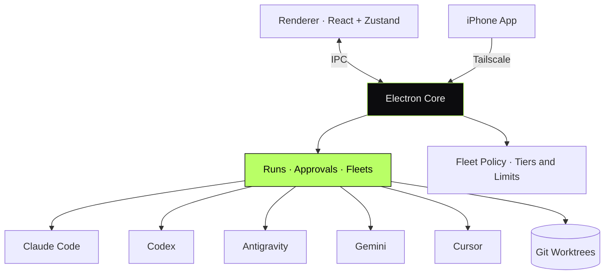

<!-- animated-project-banner -->

<picture><source media="(max-width: 600px)" srcset="assets/project-banner-mobile.svg"></picture>

<!-- /animated-project-banner -->

# DuetPro — Agent Fleets for Code

#### Every coding agent in one window.
#### One task, split across a whole fleet, one result back.

---

> **TL;DR** — A desktop app that runs Claude Code, Codex, Antigravity, Gemini and
> Cursor side by side and lets one agent split a task across dozens of others.
> It has no model and no API keys of its own: it drives the CLIs already signed
> in on your machine.

---

## Overview

DuetPro is a desktop app for coding agents on macOS, Windows and Linux. You can
switch agents in the middle of a chat, or hand a large task to an agent that
divides it, waits for its fleet and assembles the result. A live graph shows
who started whom and what each agent is doing.

A native iPhone app follows the same work over a private Tailscale network.

DuetPro started from the code of Duet by [Anton](https://github.com/alhimikix)
and has grown into its own product.

> This repository documents the system at the **architectural level**.
> Implementation code is private.

---

## My Role

> **Lead Engineer.** Fleet orchestration, security and the product built on top.

- Fleet engine: queue, agent tree, worktrees, result collection
- Security audit and hardening of the base app
- Adapters for each coding agent
- Native iPhone app and phone server
- Proof of done, production watchdog, briefs and project memory

---

## Architecture

---

## System Components

| Component | Responsibility | Stack |
|---|---|---|
| **Renderer** | Chat feed, live fleet graph, summaries | React · Zustand |
| **Electron Core** | Chats to runs, approvals, fleets | Electron · Node.js |
| **Providers** | Translate each CLI's event stream into one protocol | `node-pty` · Claude Agent SDK · ACP |
| **Fleet Policy** | Agent tiers, concurrency, per-task budgets | Node.js |
| **iPhone App** | Follow and reply from the phone | SwiftUI |

---

## Capabilities

- **Agent fleets** — one call starts a batch of agents, and they can start their own
- **Live graph** — the whole agent tree and each agent's state in one place
- **Switch agents mid-chat** — the next message goes to another agent with the context
- **Proof of done** — conditions of done checked against recorded runs
- **Production watchdog** — scheduled health checks that run without a model
- **Teams without a server** — several people on one project, each on their own Mac

---

## Architectural Decisions & Tradeoffs

### 1. No model and no keys of its own

DuetPro drives CLIs that are already installed and signed in, so everything runs
on the subscriptions the user already has. The cost is tracking every CLI's
behaviour as it changes.

### 2. One event protocol for every provider

Each provider translates its stream into a shared protocol. The interface only
knows that protocol, so a new agent does not change the UI.

### 3. A waiting parent does not hold a slot

A queue limits how many agents work at once, and a parent waiting for its
children gives up its slot, so a deep agent tree does not starve its own children.

### 4. Each writing agent in its own worktree

Agents that edit code get their own git branch and worktree. Results are
collected from the bottom of the tree up, and the lead reviews them before merging.

### 5. "Done" needs evidence

The lead agent records up to five conditions of done, and each one is proven by
a recorded run or screenshot. The app checks the run exists; free text is never proof.

### 6. Agent output is untrusted input

A README in someone else's repository can carry a prompt injection. Images in
answers do not load automatically, the built-in browser rejects `file://` and
arbitrary schemes, and executable files do not open from a link.

---

## Engineering Invariants

- **Never** auto-load remote content from an agent's answer
- **Never** accept free text as proof that work is done
- **Never** let a child agent outrank its parent
- **Never** keep a bot token in plain text
- **Never** require an API key for a CLI that is already signed in

---

## Related Public Documents

- [`ai-engineering-agent`](https://github.com/eldardzh/ai-engineering-agent) — agent loop with planning and tools

---

#### **Contact**
[**@EldarDissmay**](https://x.com/EldarDissmay) · **dissmay21@gmail.com**

© 2026 · Eldar D. · Built 2026.

